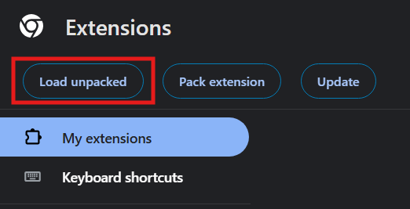
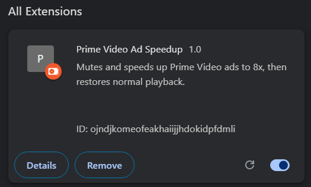

# prime-ad-speedup
Speed up ads on Prime Video

## How to set it up
Since I do not feel like creating a real extension. Here are the simple steps to start using this. Making the source code open so you can scan through it yourself and see what it is doing. With the help of Google's AI it took all of 20 minutes to create and debug. Might not be perfect, but feed it to the Google AI and it can probably help fix any issues.

1. Clone the repository or copy the manifest.json and content.js into a folder on your computer.
2. Navigate to chrome://extensions in your browser.
3. Enable the developer mode toggle in the top right. 
4. Click on the Load unpacked button in the top left of the extensions page and navigate to the cloned repository folder or the folder you created and placed the manifest.json and content.js into. 
5. You will see the extension loaded and looking like this in your list of extensions. 
6. Refresh your Prime Video tab and enjoy your shows without the annoying ads.
